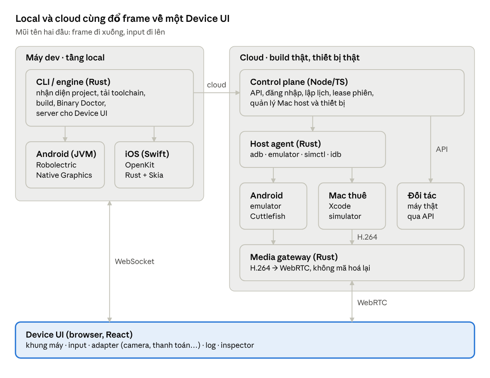
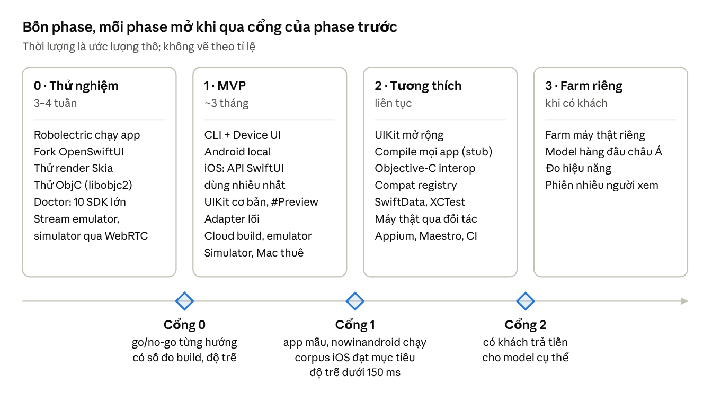

# Iris — Plan & Stack

14/10/2026 · Tri

> Bản xuất từ tài liệu Claude Docs "Iris — Plan & Stack" ngày 14/10/2026. Bản gốc (sửa và comment được): https://claude.ai/code/artifact/e38b9ae5-5779-42fc-a076-f9fb4416b193

Iris cho dev chạy và test app Android (Kotlin/Java) và iOS (Swift/SwiftUI) thẳng từ source — không thiết bị, không cài Android Studio hay Xcode, một lệnh như `npm start`. Ba tầng chạy: local, thiết bị ảo trên cloud, máy thật qua đối tác. iOS là điểm khác biệt: dồn lực để chạy được nhiều app iOS nhất mà không cần Mac, Android đi song song. Core viết bằng Rust, control plane Node/TS, FE React.

## Quyết định

Các quyết định dưới đây là nền của toàn bộ plan. Dòng "Mặc định" là đề xuất của plan; team xác nhận bằng cách đổi trạng thái.

| Quyết định | Chọn | Trạng thái |
| --- | --- | --- |
| Thứ tự các tầng | Local + thiết bị ảo trên cloud trong MVP; máy thật đi qua đối tác trước | Đã chốt |
| Mac cho iOS trên cloud | User tự thuê và cấu hình (BYO Mac host); Iris chỉ điều phối | Đã chốt |
| Ký app iOS cho máy thật | Tài khoản Apple Developer của dev | Đã chốt |
| Thị trường | Châu Á | Đã chốt |
| Ngôn ngữ core | Rust, Node/TS, Java/Kotlin, C; Swift ở phần iOS bắt buộc | Đã chốt |
| Trọng tâm nền tảng | iOS là điểm khác biệt, nhận đội lớn nhất; Android đi song song | Đã chốt |
| Lõi SwiftUI | Fork OpenSwiftUI để tuỳ biến dễ hơn; định kỳ kéo thay đổi từ upstream | Đã chốt |
| Tên sản phẩm | Iris; tên kỹ thuật irisrun (lệnh CLI, npm, crates, GitHub, irisrun.dev) | Đã chốt |
| Điểm đặt hạ tầng đầu tiên | Singapore (phủ Đông Nam Á) | Mặc định — cần xác nhận |
| Local hay hosted trước | Local CLI trước; kiến trúc đóng container được về sau | Mặc định — cần xác nhận |
| OS của dev | macOS, Linux; Windows qua WSL2 | Mặc định — cần xác nhận |
| Frontend | React + TypeScript + Vite | Mặc định — cần xác nhận |

## Thực tế kỹ thuật

Android đạt độ chính xác cao ngay ở local; iOS ở local khó nhất nhưng là điểm khác biệt; phần chưa phủ chạy trên simulator cloud.

- **Android:** AOSP là mã nguồn mở, nên chạy được chính framework Android trên JVM bằng Robolectric. Chế độ Native Graphics vẽ pixel thật; không cần emulator, không phải viết lại `android.*`.
- **iOS:** UIKit và SwiftUI là mã đóng, chỉ chạy trên OS của Apple. Ở local phải viết lại toàn bộ API (OpenKit) và không bao giờ đủ 100%. Chính chỗ khó này là điểm khác biệt: plan dồn lực để phủ nhiều app nhất, phần còn thiếu tự chuyển sang simulator cloud.
- **Không cài môi trường:** dev không tự cài gì; CLI tự tải toolchain vào `~/.irisrun` như npm tải `node_modules`. Compiler Kotlin/Swift vẫn cần, chỉ được giấu đi. Lần đầu tải khoảng 1–2 GB, các lần sau dùng cache.
- **Binary native** (`.so`, `.xcframework`) không chạy thẳng được trên máy dev. Binary Doctor chọn cách chạy cho từng binary (xem mục Binary native).

## Kiến trúc



Dev chạy một lệnh: CLI build và chạy app ở local, hoặc gửi source lên control plane để chạy trên emulator, simulator trên Mac do user thuê, hay máy thật của đối tác. Device UI nhận frame qua WebSocket (local) hoặc WebRTC (cloud) và gửi input ngược lại.

## Tầng local: Android

Code Android được build bằng chính Gradle/AGP của project rồi chạy trên Robolectric 4.17 với Native Graphics. View và Compose được vẽ bằng framework AOSP thật, không cần emulator.

1. Nhận diện module có plugin `com.android.application`.
2. Chạy `gradlew --init-script irisrun.gradle`: thêm Robolectric và host vào classpath test, bật `includeAndroidResources`, ghi classpath ra file. Không sửa file nào của project.
3. `java … HostMain` mở sandbox Robolectric (`@GraphicsMode(NATIVE)`, cấu hình màn hình qua qualifiers) và khởi động Activity launcher.
4. Vòng lặp: nhận input → `idleFor(dt)` để đồng hồ giả chạy theo giờ thật → vẽ mọi window (activity, dialog, popup) → so với frame trước → gửi frame. Mục tiêu ≥ 15 fps.
5. Host đóng vai ActivityManager: back stack, `startActivityForResult`; intent ra ngoài app chuyển cho adapter.

Toolchain tự tải: JDK 21 (Temurin), Gradle qua wrapper của project, `android.jar` do AGP tự tải sau khi dev đồng ý license một lần. Không có Android Studio, emulator hay system image.

- **Chạy nguyên:** View/XML, Compose, Navigation, ViewModel, Room/DataStore/SharedPreferences, Retrofit/OkHttp (gọi mạng thật), Hilt, phần lớn SDK viết thuần Kotlin/Java.
- **Cần adapter:** WebView, OpenGL/SurfaceView/video, Google Play Services (Maps, FCM, Billing, Sign-in), thư viện `.so`, phần cứng (BLE, NFC, cảm biến).
- **Hot reload ở MVP:** build incremental rồi khởi động lại sandbox; nạp code nóng mà giữ state để sau.

## Tầng local: iOS

Code Swift được compile bằng Swift toolchain trên Linux và link với OpenKit, bộ API iOS do mình tự viết lại. Mục tiêu là chạy được nhiều app iOS nhất mà không cần Mac; phần chưa phủ tự chuyển sang simulator cloud.

1. Đọc `.xcodeproj` (file thuộc app target, Assets, thư viện SPM) hoặc `Package.swift`.
2. Sinh package SwiftPM tạm trong `.irisrun/build`, link với OpenKit. Bỏ các khối `#Preview {}`; `-module-alias` cho `import SwiftUI` trỏ sang OpenKit, nên code của dev giữ nguyên.
3. Runtime: reconciler giữ identity của view theo vị trí trong cây; `@State`, `@Binding`, `@StateObject`, `@Environment`, `@AppStorage` qua reflection; `@Observable` qua `withObservationTracking`.
4. OpenKit tự tính layout theo thuật toán của SwiftUI và Auto Layout, vẽ bằng render core (Rust + Skia), rồi gửi frame về Device UI giống Android.

Toolchain tự tải: Swift 6.4.1 (bản mới nhất) từ swift.org (Foundation, Dispatch, Observation có sẵn trên Linux). Ubuntu 20.04 chỉ có bản tới Swift 6.1.2, nên khuyến nghị Ubuntu 22.04/24.04.

Khoảng trống lớn nhất ở local là Objective-C (`#selector`, `@objc`, KVO không compile trên Linux vì thiếu ObjC runtime), các framework Apple chưa viết lại, và độ khớp giao diện. Cách lấp từng khoảng trống nằm ở mục Chiến lược phủ tối đa app iOS. Font SF và SF Symbols thì không bao giờ dùng được (license Apple), nên chữ có thể xuống dòng khác iOS thật.

## Chiến lược phủ tối đa app iOS

Chạy app iOS mà không cần Mac là điểm khác biệt của Iris, nên iOS đi chín hướng song song. Thứ tự làm trong mỗi hướng xếp theo số liệu thật về API mà app đang dùng (hướng 8).

| Hướng | Làm gì | Tái dùng, ghi chú |
| --- | --- | --- |
| 1. Lõi SwiftUI | Reconciler, AttributeGraph, layout đúng ngữ nghĩa SwiftUI | Fork [OpenSwiftUI](https://github.com/OpenSwiftUIProject/OpenSwiftUI) (MIT) để tuỳ biến tự do, dùng kèm [OpenAttributeGraph](https://github.com/OpenSwiftUIProject/OpenAttributeGraph). Trên Linux dự án mới có renderer stdout; mình viết backend render. Giữ license MIT và định kỳ kéo thay đổi từ upstream |
| 2. Render core | Cây layer kiểu CALayer, chữ, ảnh, animation; xuất frame | Rust + [rust-skia](https://github.com/rust-skia/rust-skia) (MIT); Swift gọi qua C ABI |
| 3. UIKit | UIView, UIViewController, Auto Layout, UITableView, UICollectionView, navigation; nạp storyboard và XIB | Tự viết; Auto Layout dùng thuật toán Cassowary |
| 4. Framework khác | Combine, SwiftData/CoreData trên SQLite, StoreKit 2, PhotosUI, CoreLocation, UserNotifications, LocalAuthentication, Keychain, Swift Charts | Foundation có sẵn ([swift-foundation](https://github.com/swiftlang/swift-foundation)); chép OpenCombine vào repo; WebKit, MapKit, AVPlayer dùng overlay adapter |
| 5. Compile được mọi app | Danh mục API lấy từ tài liệu công khai của Apple, sinh stub cho API chưa làm. App compile được, chỉ dừng khi gọi đúng API thiếu, và CLI báo đó là API nào | Cần tư vấn pháp lý; không dùng file nào trong Apple SDK |
| 6. Objective-C | Toolchain Swift có ObjC interop trên Linux: chạy được file `.m`, `#selector`, `@objc`, KVO, pod viết bằng ObjC | R&D rủi ro cao, dùng [libobjc2](https://github.com/gnustep/libobjc2) (MIT) + clang. Trước mắt tự viết lại các mẫu phổ biến bằng SwiftSyntax |
| 7. Thư viện bên thứ ba | Compat registry: patch và adapter cho package phổ biến (Alamofire, Kingfisher, SnapKit, Lottie, Realm, Firebase, Stripe…) | SDK dạng binary: sinh stub từ `.swiftinterface` của chính vendor |
| 8. Đo và xếp ưu tiên | Chạy hằng đêm corpus app mã nguồn mở; so ảnh với simulator thật trên Mac CI; telemetry (opt-in) về API thiếu; bảng điểm tương thích công khai | Corpus lấy từ [open-source-ios-apps](https://github.com/dkhamsing/open-source-ios-apps) |
| 9. Công cụ cho dev | Gallery `#Preview` trên Windows/Linux, chạy XCTest và Swift Testing trên Linux, debug bằng LLDB; XCUITest trên runtime để sau | [swift-corelibs-xctest](https://github.com/swiftlang/swift-corelibs-xctest), [swift-testing](https://github.com/swiftlang/swift-testing) |

**Không làm:** chạy framework hay simulator của Apple trên máy không phải Apple. [Xcode and Apple SDKs Agreement](https://www.apple.com/legal/sla/docs/xcode.pdf) mục 2.5 và 2.7 cấm chạy bất kỳ phần nào của Apple Software trên phần cứng không phải Apple, và cấm giúp người khác làm vậy.

**Nhân sự:** iOS là đội lớn nhất (Swift runtime, render core, toolchain); con số cụ thể ở mục Lộ trình.

## Tầng cloud

Cùng một lệnh, đổi target là source được build thật trên cloud, cài lên thiết bị và stream về cùng Device UI. Dev vẫn không cài gì.

```
irisrun start                          # local
irisrun start --target cloud           # emulator / simulator
irisrun start --device "Galaxy A55"    # máy thật (qua đối tác)
```

| | Thiết bị ảo | Máy thật |
| --- | --- | --- |
| Độ chính xác | Cao: OS thật, phần cứng giả lập | 100% |
| Nguồn thiết bị | Android: pool server của Iris. iOS: Mac do user thuê | Đối tác (giai đoạn đầu) |
| Android | Emulator trên server có KVM; emulator chỉ có bản Linux x86_64, image x86_64 của Google tự dịch ARM. Server ARM64 dùng Cuttlefish | adb + scrcpy |
| iOS | Simulator trên Mac; bản build cho simulator không cần ký | go-ios + WebDriverAgent; app ký bằng tài khoản dev |
| Không làm được | Camera, cảm biến, GPU và hiệu năng thật, lỗi riêng của hãng | Thao tác vật lý như Face ID thật |

### Mac do user tự thuê

User thêm Mac host trong Console theo một trong hai cách. Iris chỉ điều phối; chi phí và việc tuân thủ EULA macOS nằm trong hợp đồng thuê của user.

1. **Kết nối tài khoản AWS** bằng IAM role quyền tối thiểu: Iris cấp phát EC2 Mac ở region user chọn và cài agent qua user-data.
2. **Mac bất kỳ** user đã thuê hoặc sở hữu (MacStadium, colocation, Mac mini ở văn phòng): chạy một lệnh cài agent kèm token đăng ký.

- Agent tự kết nối ra control plane qua mTLS, không mở cổng vào. Mỗi Mac thuộc một tổ chức, không dùng chung giữa các khách.
- EC2 Mac tính tối thiểu 24 giờ mỗi lần cấp phát. Scheduler vì vậy giữ host chạy liên tục và xếp nhiều simulator lên một Mac, không bật/tắt theo phiên.
- Ở châu Á, FAQ của AWS ghi EC2 Mac bản Intel có ở Mumbai, Seoul, Singapore, Sydney, Tokyo; bản M1 có ở Singapore. Ưu tiên Apple Silicon và kiểm tra các đời máy mới hơn trong console khi triển khai.

### Ký app iOS bằng tài khoản dev

- Bản cho simulator không cần ký.
- Bản cho máy thật: dev cung cấp App Store Connect API key. `xcodebuild -allowProvisioningUpdates -allowProvisioningDeviceRegistration` tự đăng ký thiết bị và tạo profile. Key chỉ nằm trong keychain của Mac host, Iris không giữ.
- Apple cho mỗi tài khoản đăng ký tối đa 100 thiết bị mỗi dòng sản phẩm mỗi năm thành viên; máy thật dùng để test tiêu vào quota này.
- Máy thật qua đối tác thường bị đối tác ký lại, mất push, App Groups… Muốn giữ chữ ký của dev thì thuê máy riêng (private device) và thêm UDID vào tài khoản dev.

### Luồng một phiên

- Lần chạy sau chỉ gửi phần source thay đổi. Workspace build của mỗi dev được giữ sẵn để build incremental, rồi `adb install -r` hoặc `simctl install`.
- Mỗi phiên giữ thiết bị bằng lease + heartbeat. Hết phiên: gỡ app, xoá dữ liệu, reset quyền.
- Màn hình stream bằng H.264 qua WebRTC; input đi ngược qua data channel.

### Test tự động và CI

- Endpoint Appium 2 (UiAutomator2/XCUITest): bộ test sẵn có của dev chạy được ngay.
- Maestro (flow YAML) cho test nhanh; vẫn chạy được Espresso/XCUITest gốc.
- Ghi lại thao tác tay rồi sinh ra flow Maestro.
- Chạy song song nhiều thiết bị từ CI; kết quả gồm video, log, ảnh chụp màn hình, số đo CPU/RAM/FPS.

### Châu Á

- Control plane và pool Android bắt đầu ở Singapore; thêm Tokyo/Mumbai khi có người dùng Đông Bắc Á/Ấn Độ. Mục tiêu độ trễ tương tác dưới 150 ms.
- Máy thật chọn theo thị phần từng nước: Samsung, Xiaomi/Redmi, OPPO, vivo, realme, vài đời iPhone gần đây.
- Trung Quốc không có Google Play Services, và máy Huawei chạy HarmonyOS NEXT không chạy app Android: ngoài phạm vi giai đoạn đầu.
- Đối tác máy thật phải có data center ở châu Á. AWS Device Farm chỉ có ở us-west-2 (Oregon), phiên tương tác tối đa 150 phút: chỉ hợp test tự động.
- Lưu source và log theo quy định dữ liệu từng nước (ví dụ Việt Nam, Indonesia, Trung Quốc).

### Khi tự xây farm máy thật (Phase 3)

- Hub USB bật/tắt nguồn được từng cổng, để giới hạn sạc, chống phồng pin và khởi động lại từ xa.
- Reset sau mỗi phiên, wipe định kỳ. iPhone ở chế độ supervised + MDM, Android là device owner, để khoá cài đặt và tài khoản.
- Mỗi máy một VLAN, ra internet qua proxy; không giữ dữ liệu của khách.

## Adapter và in-app agent

Mỗi adapter là một hợp đồng request/response có schema trong protocol, cài đặt ở hai đầu: runtime và Device UI. App dùng SDK chưa có adapter thì CLI báo trước khi chạy, không để crash giữa chừng.

| Adapter | Android local | iOS local | Emulator | Simulator | Máy thật |
| --- | --- | --- | --- | --- | --- |
| Camera | `ACTION_IMAGE_CAPTURE`, `TakePicture` trả ảnh từ webcam hoặc file | `PhotosPicker`, `UIImagePickerController` | Webcam → v4l2loopback → `-camera-back webcam0` | In-app agent; `simctl addmedia` cho thư viện ảnh | In-app agent bơm hình |
| Thanh toán | Shadow `BillingClient` | StoreKit 2, sản phẩm đọc từ file `.storekit` | Agent giả lập (Play Billing cần Play Store) | StoreKit Testing (cần kiểm chứng) hoặc agent | Sandbox thật hoặc agent |
| Lưu trữ | Prefs/Room/DataStore chạy thật, lưu ở `.irisrun/data`; AndroidKeyStore → JCA provider giả | UserDefaults/FileManager → `.irisrun/data`; Keychain → shim `Security` | Thật | Thật | Thật |
| Vị trí | Shadow LocationManager | Shim CoreLocation | `geo fix` | `simctl location` | App giả lập vị trí (Android), go-ios (iOS) |
| Push | Shadow FCM | Shim UserNotifications | FCM thật, `cmd notification` | `simctl push` | FCM/APNs thật, key của dev |
| Sinh trắc | Shadow BiometricPrompt | Shim LocalAuthentication | `finger touch` | `notifyutil` (BiometricKit_Sim) | Agent giả lập |
| Mạng | Mạng thật | Mạng thật | `network speed/delay` + mitmproxy | Proxy + Network Link Conditioner trên host | Proxy riêng từng máy |
| Deep link | Intent router | `onOpenURL` | `am start -d` | `simctl openurl` | adb, go-ios |
| WebView, bản đồ, video | Overlay adapter | Overlay adapter | Thật | Thật | Thật |

Phía Device UI: webcam (`getUserMedia`) hoặc chọn file; payment sheet giả (thành công, từ chối, pending, huỷ); xem và xoá dữ liệu app; Geolocation API; nút gửi push; nút sinh trắc khớp hoặc không khớp.

**Overlay adapter:** runtime báo toạ độ của view không vẽ được (WebView, bản đồ, video), browser vẽ `<iframe>`, bản đồ web hoặc `<video>` đè đúng chỗ.

**In-app agent:** vì build từ source, bản debug được chèn tự động một agent nhỏ. Android là AAR chỉ có trong bản debug; iOS là dylib nạp qua `DYLD_INSERT_LIBRARIES` trên simulator, hoặc framework link vào bản debug cho máy thật. Agent bơm hình camera, giả lập thanh toán, ghi log mạng và cung cấp cây view cho inspector, nên một contract adapter dùng chung cho mọi tầng.

## Binary native

Binary Doctor đọc mọi `.so`, `.xcframework`, `.framework`, `.a`, `.dylib` trong project trước khi build, rồi chọn cách chạy khả thi đầu tiên cho từng binary. Kết quả quyết định tầng chạy: binary không giải được ở local thì CLI đề xuất chạy trên cloud.

Doctor đọc: kiến trúc CPU (ELF `e_machine`, Mach-O `cputype`); ABI (bionic qua `.note.android.ident` hoặc `linker64`, hay glibc; nền tảng Apple qua `LC_BUILD_VERSION`); API level tối thiểu; thư viện phụ thuộc (`DT_NEEDED`, `LC_LOAD_DYLIB`); hàm JNI (`JNI_OnLoad`, `Java_*`); có `.swiftinterface` hay không.

**`.so` của Android**, theo thứ tự thử:

1. Có source NDK → build lại cho máy chạy, link với `ndk-host` (bản host của liblog, libandroid). Tốt nhất.
2. Có bản build đúng kiến trúc máy chạy (đa số SDK có sẵn `x86_64` cho emulator) → nạp qua loader chuyển bionic sang glibc, theo hướng libhybris hoặc bionic_translation (kiểm tra license).
3. Chỉ có kiến trúc khác → chạy cả runtime dưới FEX, box64 hoặc QEMU-user (chậm), hoặc chuyển lên emulator cloud.
4. Cần GPU, DRM, phần cứng → JNI stub sinh từ bảng symbol, hoặc emulator cloud.

**Binary iOS** (Mach-O không chạy được trên Linux), theo thứ tự thử:

1. Framework Swift có `.swiftinterface` của vendor → sinh module stub cùng API, thêm adapter hành vi cho SDK phổ biến (compat registry).
2. Binary ObjC/C++ → stub từ header của vendor; nếu vendor có source thì build từ source khi hướng Objective-C xong.
3. Cần hành vi thật → simulator cloud (bản `ios-arm64-simulator` chạy trực tiếp trên Mac Apple Silicon).

## Stack core

Core dùng Rust cho CLI, agent, media, Doctor và render core của OpenKit; Node/TS cho control plane; Java/Kotlin cho Android runtime; C cho lớp ABI native; Swift ở phần iOS bắt buộc.

| Thành phần | Ngôn ngữ | Thư viện chính | Lý do |
| --- | --- | --- | --- |
| CLI + engine local (nhận diện project, tải toolchain, điều phối build, theo dõi thay đổi, server cho Device UI) | Rust | tokio, axum, reqwest, notify, clap; phát hành bằng [cargo-dist](https://github.com/axodotdev/cargo-dist) (script shell, Homebrew, npm) | Một file chạy, không cần runtime; `npx irisrun` vẫn dùng được |
| Binary Doctor | Rust | [goblin](https://github.com/m4b/goblin) | Đọc ELF/Mach-O ổn định; dùng chung cho CLI và agent |
| Render core của OpenKit | Rust | [rust-skia](https://github.com/rust-skia/rust-skia) | Layer tree, chữ, animation; Swift gọi qua C ABI |
| Host agent (server Linux, Mac do user thuê) | Rust | tokio, gRPC; điều khiển adb, emulator, simctl, idb, go-ios | Tiến trình chạy lâu, nhẹ, một codebase cho macOS và Linux |
| Media gateway | Rust | [str0m](https://github.com/algesten/str0m) (WebRTC), coturn | Chuyển thẳng H.264, không mã hoá lại |
| Control plane (API, đăng nhập, quản lý thiết bị và Mac host, lập lịch, phiên, kết quả test) | Node + TypeScript | Fastify, Connect-RPC, Drizzle, PostgreSQL (hàng đợi bằng `SKIP LOCKED`), S3 | Phần nghiệp vụ; dùng chung TypeScript và người với FE |
| Android runtime + in-app agent | Java/Kotlin | Robolectric, Gradle init script | Bắt buộc chạy trên JVM |
| Lớp native ABI (ndk-host, loader bionic, JNI stub) | C | Tham khảo libhybris, bionic_translation | Export đúng symbol C, kể cả hàm variadic như `__android_log_print` |
| OpenKit (SwiftUI, UIKit, framework khác) + in-app agent iOS | Swift (bắt buộc) | Fork OpenSwiftUI, OpenAttributeGraph, swift-foundation, OpenCombine | Phải compile chung với code Swift của app |
| Objective-C trên Linux (R&D) | C, C++ | [libobjc2](https://github.com/gnustep/libobjc2), clang, toolchain Swift tự build | Chạy code ObjC, `#selector`, `@objc` của app |
| Schema dùng chung | Protobuf + Buf | prost, [protobuf-es](https://github.com/bufbuild/protobuf-es), protobuf-kotlin, [swift-protobuf](https://github.com/apple/swift-protobuf) | Một nguồn schema cho năm ngôn ngữ; `buf breaking` chặn thay đổi làm vỡ tương thích |
| Hạ tầng | — | Kubernetes trên bare-metal có KVM, MinIO/S3, Prometheus + Grafana + Loki, OpenTelemetry | |

Vì sao CLI viết bằng Rust: dev mobile thường không cài sẵn Node, và một file chạy độc lập đúng tinh thần không cài môi trường. CLI, agent và render core dùng chung crate. Node dành cho chỗ nó mạnh nhất: API nghiệp vụ và FE.

**Cấu trúc repo:**

```
proto/                    Protobuf + buf
crates/                   Rust: cli, engine, doctor, agent, media, render
services/control-plane/   Node/TS
apps/web/                 React: Device + Console
runtimes/android/         Java/Kotlin: Robolectric host, shadows, agent
runtimes/ios/             Swift: OpenKit (trên fork OpenSwiftUI), agent
native/                   C: ndk-host, loader, objc (R&D)
examples/                 app mẫu, đồng thời là bộ test tương thích
```

CI dùng GitHub Actions, cần runner macOS để chụp ảnh tham chiếu từ simulator thật cho bảng điểm tương thích iOS.

## Frontend

FE là một SPA React gồm hai khu: Device (dùng cho cả local và cloud) và Console (cloud). Cả Android lẫn iOS đều gửi frame, nên Device UI chỉ cần một bộ hiển thị chung.

| Hạng mục | Chọn | Ghi chú |
| --- | --- | --- |
| Nền tảng | React 19 + TypeScript + Vite | CLI nhúng sẵn bản build vào file chạy Rust |
| Routing, gọi API | TanStack Router + TanStack Query; client sinh từ Protobuf (connect-es) | Kiểu dữ liệu khớp từ backend tới UI |
| State | Zustand; frame vẽ thẳng lên `<canvas>`, ngoài state của React | Tránh React render lại 30 lần mỗi giây |
| UI kit | Tailwind CSS v4 + shadcn/ui (Radix) | Có sẵn accessibility, code component nằm trong repo |
| Log, bảng | TanStack Virtual + TanStack Table | Log hàng trăm nghìn dòng |
| Video | Local: WebSocket + `createImageBitmap`. Cloud: WebRTC. WebCodecs khi chuyển sang H.264 | API có sẵn của browser |
| Biểu đồ | ECharts | Số đo CPU/RAM/FPS, bảng điểm tương thích |
| Test | Vitest + Testing Library; Playwright cho E2E | |
| Docs, landing | Astro Starlight | |
| Để sau | Tauri (tái dùng core Rust) cho app desktop; extension VS Code | Chỉ làm khi có nhu cầu |

**Device UI:**

- Khung máy theo từng dòng máy (kích thước, mật độ điểm ảnh, tai thỏ, vùng an toàn); xoay màn hình, dark mode, ngôn ngữ, cỡ chữ.
- Nhập liệu: chuột thành thao tác chạm, giữ Alt + kéo để pinch; nút back, home, recents, âm lượng, nguồn; gõ chữ qua `<textarea>` ẩn có xử lý `composition*`, để bộ gõ tiếng Việt, Trung, Nhật, Hàn hoạt động đúng.
- Panel: log, request mạng, cây view, điều khiển adapter, quay video, chụp màn hình.
- Riêng iOS: gallery `#Preview` của project; báo cáo tương thích liệt kê API chưa hỗ trợ mà app gọi tới, kèm nút chuyển sang simulator cloud.
- Riêng cloud: chia sẻ link phiên cho nhiều người cùng xem; xem lại video phiên với log khớp theo thời gian.

**Console (cloud):** tổ chức và thành viên; thêm Mac host (kết nối AWS hoặc cài agent); danh sách thiết bị và phiên; lịch sử test và CI; API key; chi phí sử dụng.

## Lộ trình



Phase 0 quyết định hướng nào đi tiếp, nên con số mục tiêu của cổng 1 (tỉ lệ corpus iOS compile và chạy được) sẽ chốt ở cuối Phase 0. Nhân sự ước lượng thô cho MVP: iOS 5–6 người (Swift runtime, render core, toolchain), Android 2, cloud và nền tảng 3, FE 2.

Danh sách task chi tiết theo từng phase: [tasks.md](tasks.md)

## Rủi ro, pháp lý, bảo mật

Rủi ro kỹ thuật lớn nhất là độ phủ của OpenKit; rủi ro pháp lý lớn nhất là điều khoản của Apple. Vì vậy mọi thứ chạm tới Apple đều phải tự viết lại và qua tư vấn pháp lý.

| Rủi ro | Hệ quả | Cách xử lý |
| --- | --- | --- |
| OpenKit không bao giờ phủ hết API Apple | App iOS phức tạp chưa chạy được ở local | Đo bằng corpus và telemetry, làm theo thứ tự mức dùng; phần thiếu chuyển sang simulator cloud |
| Hướng Objective-C trên Linux không thành | App và pod dùng ObjC chỉ chạy được trên cloud | Coi là R&D có cổng go/no-go; trước mắt dùng SwiftSyntax viết lại mẫu phổ biến |
| [Xcode and Apple SDKs Agreement](https://www.apple.com/legal/sla/docs/xcode.pdf) mục 2.5, 2.7: cấm chạy Apple Software trên phần cứng không phải Apple | Không dùng được framework, simulator, SDK của Apple ở local | OpenKit viết lại hoàn toàn từ tài liệu công khai; không chép từ file trong Apple SDK |
| Cùng thoả thuận, mục 2.7: không cho đưa Apple Software lên mạng để nhiều máy dùng cùng lúc, trừ khi Apple cho phép | Rủi ro cho dịch vụ simulator dùng chung | Mô hình Mac do user thuê, mỗi Mac thuộc một tổ chức; tư vấn pháp lý trước khi bán |
| Cùng thoả thuận, mục 2.10: ảnh hệ thống của Apple chỉ dùng cho app chạy trên sản phẩm Apple | Không dùng được SF Symbols | Bộ icon và font thay thế; chấp nhận chữ xuống dòng khác iOS thật |
| Danh mục API lấy từ tài liệu công khai của Apple | Tranh chấp bản quyền về API | Tư vấn pháp lý trước khi làm hướng 5 |
| Robolectric không phản ánh GPU và hiệu năng thật | Không đo được hiệu năng ở local | Đo trên cloud hoặc máy thật |
| License Android SDK | AGP tải `android.jar` | Dev tự đồng ý license một lần |
| Google Play Services, libhoudini, libndk_translation là proprietary | Không đóng gói kèm được | Chỉ giả lập; dịch CPU bằng FEX, box64, QEMU |
| Image emulator có Google Play khi cung cấp cho bên thứ ba | Có thể vi phạm license | Kiểm tra license; tạm dùng image không có Play |
| Source và key ký app của khách | Rò rỉ | Mã hoá, workspace tạm; key ký chỉ nằm trên Mac của user; hướng tới SOC 2 |
| Quy định dữ liệu từng nước châu Á | Có thể phải lưu dữ liệu trong nước | Chọn region lưu trữ theo nước của khách |
| Nhãn hiệu "Iris" trùng Intel Iris và InterSystems IRIS | Khó đăng ký độc quyền tên trơn, khó lên đầu kết quả tìm kiếm | Dùng tên kỹ thuật irisrun cho CLI, npm, GitHub, irisrun.dev; tra cứu nhãn hiệu ở P0-13 |

## Câu hỏi mở

- [ ] Xác nhận các dòng "Mặc định" trong bảng Quyết định.
- [x] Đặt tên sản phẩm: Iris, tên kỹ thuật irisrun (chốt 14/10/2026).
- [ ] Tư vấn pháp lý: danh mục API từ tài liệu Apple, mục 2.7 với dịch vụ simulator, image emulator có Google Play, license libhybris và bionic_translation, tra cứu nhãn hiệu Iris.
- [x] OpenSwiftUI: fork, đã chốt 14/10/2026.
- [ ] Chọn đối tác máy thật có data center ở châu Á và đo độ trễ thực tế.
- [ ] Kiểm tra trong console AWS các đời EC2 Mac mới hơn M1 ở Singapore và Tokyo.

## Nguồn

Kiểm tra ngày 14/10/2026.

- [Maven Central: Robolectric](https://repo1.maven.org/maven2/org/robolectric/robolectric/maven-metadata.xml): bản mới nhất 4.17.
- [Gradle: phiên bản hiện tại](https://services.gradle.org/versions/current): 9.8.1.
- [Google Maven: Android Gradle Plugin](https://dl.google.com/dl/android/maven2/com/android/tools/build/gradle/maven-metadata.xml): dòng 9.x.
- [Android SDK repository](https://dl.google.com/android/repository/repository2-3.xml): emulator chỉ có bản linux_x64.
- [swift.org: cài đặt trên Linux](https://www.swift.org/install/linux/): Swift 6.4.1; từ 6.2 không còn tarball cho Ubuntu 20.04.
- [AWS: EC2 Mac FAQ](https://aws.amazon.com/ec2/instance-types/mac/faqs/): tối thiểu 24 giờ, các region châu Á.
- [AWS Device Farm endpoints](https://docs.aws.amazon.com/general/latest/gr/devicefarm.html): chỉ us-west-2, phiên tương tác tối đa 150 phút.
- [Apple: Devices overview](https://developer.apple.com/help/account/devices/devices-overview/): 100 thiết bị mỗi dòng sản phẩm mỗi năm thành viên.
- [Xcode and Apple SDKs Agreement](https://www.apple.com/legal/sla/docs/xcode.pdf): mục 2.2, 2.5, 2.7, 2.10.
- Trạng thái repo trên GitHub: [Tokamak](https://github.com/TokamakUI/Tokamak) (đã archive), [OpenCombine](https://github.com/OpenCombine/OpenCombine), [OpenSwiftUI](https://github.com/OpenSwiftUIProject/OpenSwiftUI), [OpenAttributeGraph](https://github.com/OpenSwiftUIProject/OpenAttributeGraph), [libobjc2](https://github.com/gnustep/libobjc2), [swift-foundation](https://github.com/swiftlang/swift-foundation), [rust-skia](https://github.com/rust-skia/rust-skia), [open-source-ios-apps](https://github.com/dkhamsing/open-source-ios-apps), [scrcpy](https://github.com/Genymobile/scrcpy), [idb](https://github.com/facebook/idb), [go-ios](https://github.com/danielpaulus/go-ios), [WebDriverAgent](https://github.com/appium/WebDriverAgent), [Maestro](https://github.com/mobile-dev-inc/maestro), [Cuttlefish](https://github.com/google/android-cuttlefish), [android-emulator-container-scripts](https://github.com/google/android-emulator-container-scripts), [str0m](https://github.com/algesten/str0m), [goblin](https://github.com/m4b/goblin), [cargo-dist](https://github.com/axodotdev/cargo-dist).
